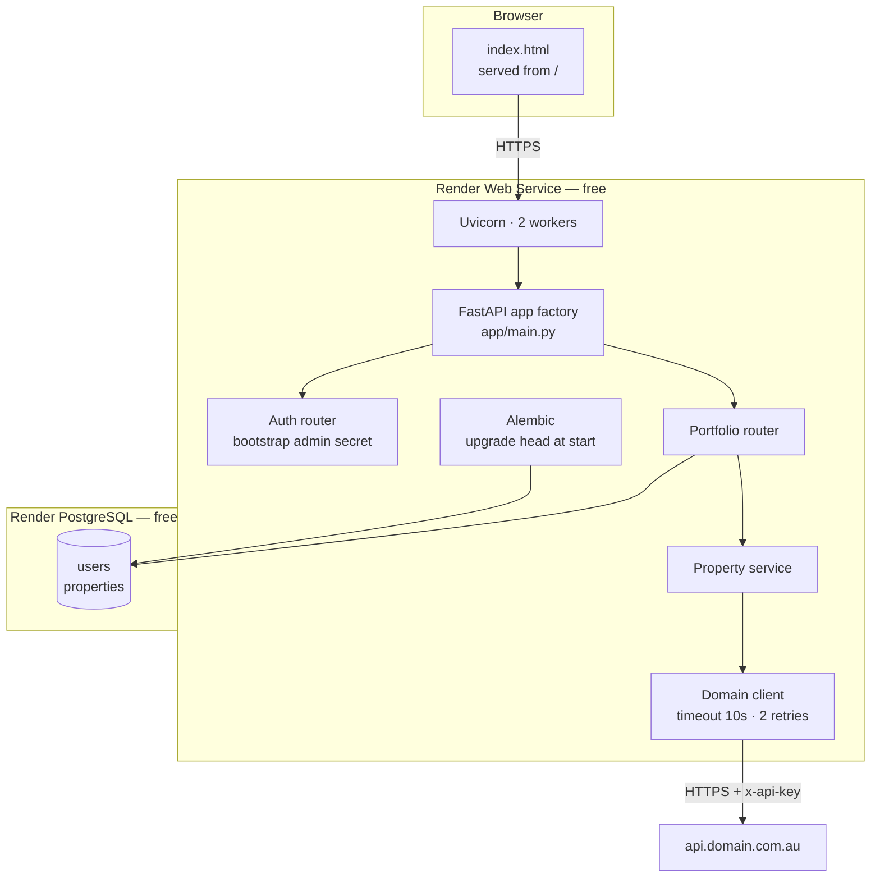

# Wealthy Property Portfolio Engine — Production Deployment Guide & Runbook

**Project:** `Portfolio_Property` (package `wealthy-property-portfolio-engine` v7.1.0)
**Hosting:** Render (Web Service + Render PostgreSQL)
**Backend:** FastAPI on Python 3.14, served by Uvicorn
**Frontend:** a single static HTML file served by the same FastAPI process
**Database:** PostgreSQL, schema owned by Alembic
**Valuation provider:** Domain.com.au developer API
**CI:** GitHub Actions, gating Render auto-deploy

**Audience:** the engineer performing the deployment. Every command is
copy-pasteable and every claim has been verified against this repository.

---

## Quick reference

| Question | Answer |
|---|---|
| Where is it hosted? | Render — Web Service (`free`) + Render PostgreSQL (`free`), region `singapore` |
| How is Python managed? | FastAPI application factory, Uvicorn ASGI server, Pydantic v2 settings |
| Deployment process? | Push to `main` → GitHub Actions runs the test suite → Render deploys on green checks |
| Project folder | `Portfolio_Property` |
| Frontend build | **None.** No React, no npm, no Node. `app/static/index.html` is served directly |
| AI provider | **Domain.com.au**, not FAL.ai. `WEALTHY_DOMAIN_API_KEY` |
| Schema migrations | Alembic. Single head `ccea021308f5` |
| Health endpoints | `/health/live` (liveness), `/health/ready` (readiness, runs `SELECT 1`) |

---

## 1. System Overview & Architecture

### 1.1 What the application is

A single FastAPI service that stores a residential property portfolio, prices
each property through the Domain.com.au AVM, and exposes the result over a
bearer-token API. There is no separate frontend build, no message queue, no
background worker, and no object storage.

### 1.2 Components

| Component | Technology | Where it runs |
|---|---|---|
| API server | FastAPI 0.162 + Uvicorn 0.54 | Render Web Service |
| Web UI | `app/static/index.html` (Tailwind + Font Awesome via CDN) | Served by the API at `/` |
| Database | PostgreSQL 15+ (Render PostgreSQL) | Render PostgreSQL, region `singapore` |
| ORM | SQLAlchemy 2.1 (sync) | In-process |
| Migrations | Alembic 1.20 | In-process, run at start |
| Valuation provider | Domain.com.au REST API | External |
| Auth | SHA-256 hashed bearer tokens, one bootstrap administrator | In-process |

### 1.3 Request flow

```
browser
  │  HTTPS
  ▼
Render edge (TLS termination)
  │
  ▼
Uvicorn (2 workers, behind Render's private network)
  ├── GET  /                        → app/static/index.html
  ├── GET  /health/live             → liveness, no dependency
  ├── GET  /health/ready            → readiness, runs SELECT 1
  ├── POST /auth/token              → issue bearer token
  ├── GET  /auth/whoami             → identify the caller
  └── /api/portfolio/*              → portfolio CRUD + transfer
        │
        ├──▶ SQLAlchemy ──▶ Render PostgreSQL
        └──▶ requests/urllib3 ──▶ api.domain.com.au
```

### 1.4 Architecture diagram



### 1.5 The provider is Domain.com.au, not FAL.ai

This project calls **one** external API, and it is not FAL.ai. There is no
`FAL_KEY` anywhere in the codebase and no fal.ai client. The provider is the
Domain.com.au developer API, authenticated with an `x-api-key` header, and
the app uses three of its endpoints:

| Endpoint | Used for |
|---|---|
| `GET /v1/properties/_suggest` | Resolve an address string to a property id |
| `GET /v1/properties/{id}` | Resolved address, sale history |
| `GET /v1/properties/{id}/priceEstimate` | The AVM (mid / low / high) |
| `GET /v1/properties/{id}/rentalEstimate` | Weekly rent estimate |

When the provider cannot produce a number, the app degrades to a labelled
algorithmic estimate rather than failing. The provenance string on every
property records which of the two produced the value, so an estimate is never
presented as an AVM. Setting `WEALTHY_STRICT_PROVIDER=true` reverses this:
the app returns `502` instead of degrading, and a missing API key becomes a
startup error.

### 1.6 There is no frontend build

The template this document was drafted from assumed a React SPA with an
`npm run build` step. That is not true of this repository. The complete
frontend is `app/static/index.html`, a single 37 KB file that pulls Tailwind
and Font Awesome from a CDN. FastAPI returns it at `/`.

Consequences worth stating plainly:

- There is no `package.json`, no `node_modules`, no `vite.config`, and no
  `.tsx`/`.jsx` file in this repository.
- Node is **not** required on the Render runtime, and the build command does
  not install it.
- The CDN dependency means the page requires internet access to Tailwind's
  and Font Awesome's CDNs. That is a client-side availability question, not
  a server one, but it is the single biggest fragility in the frontend.
- The default CORS origin, `http://localhost:5173`, is a leftover from a
  planned Vite dev server. In production the frontend is same-origin and
  `WEALTHY_CORS_ORIGINS` is set to `[]`.

## 2. Prerequisites & Environment

### 2.1 Software versions

| Component | Required | Pinned in this repo | Where it is pinned |
|---|---|---|---|
| Python | 3.11+ | **3.14** | `.python-version` |
| PostgreSQL | 15+ | Render PostgreSQL 16 or 17 | Render provisions it |
| FastAPI | 0.115+ | `>=0.162,<0.163` | `requirements.txt` |
| Uvicorn | 0.28+ | `>=0.54,<0.55` | `requirements.txt` |
| SQLAlchemy | 2.0.30+ | `>=2.1,<2.2` | `requirements.txt` |
| Alembic | 1.13+ | `>=1.20,<2` | `requirements.txt` |
| psycopg | 3.2+ | `>=3.3,<4` | `requirements.txt` |
| Node.js | **not used** | — | — |
| Nginx | **not used** | — | — |

Render's default Python for a service created on or after 2026-10-12 is
**3.14.8**. The `.python-version` file requests the `3.14` minor line, so
patch updates are picked up automatically without a code change.

> **Why uvicorn is pinned tightly.** An earlier sibling project hit a bug
> where uvicorn 0.50+ on Python 3.14 stopped invoking the request handler
> and every request hung. That project pinned `uvicorn[standard]<0.40` as a
> workaround. Here, uvicorn **0.54.0 on Python 3.14.6 has been directly
> verified** to serve requests in 0.26 s with four workers and
> `--proxy-headers`. The pin `>=0.54,<0.55` holds that verified version in
> place rather than the older one. If you raise the pin, re-run the smoke
> test in section 7 before deploying.

### 2.2 Hardware and platform limits

| Resource | Local development | Render `free` plan |
|---|---|---|
| CPU | anything modern | 0.1 CPU shared |
| RAM | 2 GB | 512 MB for the web service, 256 MB for the database |
| Disk | local | 1 GB on the database, **no disk on the web service** |
| Connections | whatever your local Postgres allows | ~100 backend connections, but see section 4.4 |
| Ephemeral filesystem | n/a | **Yes.** The web service loses all local disk on every spin-down and redeploy |
| Sleep | n/a | Spins down after 15 minutes without inbound traffic; takes about one minute to wake |

The free web service's sleep behaviour has one consequence that catches
people out: **a cold start takes about a minute**, and Render shows a
loading page while the service boots. That includes running
`alembic upgrade head`, which is a no-op after the first deploy but still
opens a database connection on the way in.

Nothing this application writes to disk survives a spin-down, which is
exactly why there is no local file storage and no media directory. Static
files live in the repository, and state lives in PostgreSQL.

### 2.3 Accounts and access needed before you start

| # | What you need | Why | Where it comes from |
|---|---|---|---|
| 1 | Write access to `github.com/vnai2009/Portfolio` | Render clones the repo | The repository owner |
| 2 | A Render account | Hosting | render.com |
| 3 | The Render GitHub App installed on the repository | `autoDeployTrigger: checksPass` needs Checks access | Render dashboard → GitHub App |
| 4 | A Domain.com.au developer API key | Real AVM valuations | developer.domain.com.au |
| 5 | A strong secret for the bootstrap administrator | The only way to sign in | `openssl rand -base64 32` |
| 6 | The local `.env` file | Local development only | This machine |

**Never paste a secret into this document, a chat message, or a git commit.**
Every secret goes into the Render dashboard's Environment tab.

### 2.4 Local development prerequisites

```bash
cd /Users/vibhachadha/Library/CloudStorage/OneDrive-Personal/ML_AI_Agent/Portfolio_Property

python3 -m venv .venv && source .venv/bin/activate
pip install -e ".[dev]"
cp .env.example .env          # then edit .env
```

> **Known trap in this working copy.** The `.venv` was created when the
> folder was named `Portfolio_Porperty`, and every script in `.venv/bin/`
> had a shebang pointing at that old path. That has been repaired
> (`Portfolio_Porperty` → `Portfolio_Property`), so `.venv/bin/pip` and
> `.venv/bin/alembic` work again. If you ever rename this folder, the
> shebangs break again. The robust workaround is
> `.venv/bin/python -m pip` and `.venv/bin/python -m alembic`, which do not
> depend on the shebang.

> **Known trap on this machine.** A bare `python3` resolves to a different
> project's virtual environment and can hang on this OneDrive-backed path.
> Always use the absolute interpreter path: `.venv/bin/python`.

---

## 3. Environment Variables & Secrets

### 3.1 The complete list

All variables use the `WEALTHY_` prefix. Everything is read by
`app/config.py` through `pydantic-settings`, which resolves them in this
order: **environment variable → `.env` file → declared default**. A bad
value fails at startup, never at 3 AM.

| Variable | Required | Production value | Purpose |
|---|---|---|---|
| `WEALTHY_DATABASE_URL` | **Yes** | injected by Render | Postgres DSN. The scheme is rewritten to `postgresql+psycopg://` at startup |
| `WEALTHY_BOOTSTRAP_ADMIN_EMAIL` | **Yes** | your email | The only email permitted to mint a token |
| `WEALTHY_BOOTSTRAP_ADMIN_SECRET` | **Yes** | generated | Shared secret for that email |
| `WEALTHY_DEBUG` | **Yes** | `false` | `false` disables `/docs`, `/redoc`, `/openapi.json` and enables the auth guard |
| `WEALTHY_DOMAIN_API_KEY` | No | `key_...` | Domain.com.au key. Blank means labelled estimates |
| `WEALTHY_APP_NAME` | No | default | Display name |
| `WEALTHY_APP_VERSION` | No | `7.1.0` | Reported by `/health/live` |
| `WEALTHY_AUTO_CREATE_TABLES` | No | `false` | **Keep false.** `create_all()` can never ALTER an existing schema |
| `WEALTHY_DB_POOL_SIZE` | No | `1` | Persistent DB connections per worker |
| `WEALTHY_DB_MAX_OVERFLOW` | No | `2` | Extra DB connections per worker |
| `WEALTHY_DB_POOL_TIMEOUT` | No | `10` | Seconds to wait for a pooled connection |
| `WEALTHY_ALLOW_ESTIMATE_FALLBACK` | No | `true` | Degrade to a labelled estimate when Domain is down |
| `WEALTHY_STRICT_PROVIDER` | No | `false` | `true` returns 502 instead, and makes a missing key a startup error |
| `WEALTHY_DOMAIN_AUTH_MODE` | No | `api_key` | `api_key` sends `x-api-key`; `bearer` sends `Authorization` |
| `WEALTHY_DOMAIN_BASE_URL` | No | default | `https://api.domain.com.au` |
| `WEALTHY_DOMAIN_TIMEOUT` | No | `10` | Read timeout, seconds |
| `WEALTHY_DOMAIN_CONNECT_TIMEOUT` | No | `3.05` | Connect timeout, seconds |
| `WEALTHY_DOMAIN_RETRIES` | No | `2` | Retry count for 429 and 5xx |
| `WEALTHY_DOMAIN_BACKOFF_FACTOR` | No | `0.5` | urllib3 backoff factor |
| `WEALTHY_CORS_ORIGINS` | No | `[]` | Same-origin only. Never `*` |
| `WEALTHY_ALLOW_SELF_SERVICE_TOKENS` | No | `false` | Permit token issuance for any email. Dev only |

### 3.2 Generating the secrets

```bash
# The bootstrap administrator secret — this is how you sign in.
openssl rand -base64 32

# Verify the DSN scheme rewrite works before you deploy it.
.venv/bin/python -c "from app.config import Settings; print(Settings().database_url)"
```

Render can generate the bootstrap secret for you. `render.yaml` marks
`WEALTHY_BOOTSTRAP_ADMIN_SECRET` with `generateValue: true`, which produces
a random 256-bit base64 value. **Read it back from the service's Environment
tab after the first deploy.** You need it to sign in, and nobody else should
ever see it.

If you prefer to choose the secret yourself, replace that entry in
`render.yaml` with `sync: false` and paste in your own value.

### 3.3 The authentication model in production

The development build exposes `POST /auth/token`, which mints a working API
token for any email address with no password. The code's own docstring called
it a local-development convenience. Deployed to a public URL it would let
anyone claim any identity and read and write that identity's portfolio.

The production build closes it. With `WEALTHY_BOOTSTRAP_ADMIN_EMAIL` and
`WEALTHY_BOOTSTRAP_ADMIN_SECRET` set, the endpoint accepts exactly one
email, and only with the correct secret:

| Request | Response |
|---|---|
| Admin email, correct secret | `201` with a token |
| Admin email, wrong secret | `401 Invalid credentials.` |
| Admin email, no secret | `401 Invalid credentials.` |
| Any other email, with or without the secret | `403 Self-service token issuance is disabled.` |

The comparison is constant-time (`hmac.compare_digest`). The secret is never
written to the database, never returned in a response, and never logged.

There is a second guard. When `WEALTHY_DEBUG=false` and no bootstrap admin
is configured, the application **refuses to start**:

```
ValueError: WEALTHY_DEBUG=false requires closed authentication. Set
WEALTHY_BOOTSTRAP_ADMIN_EMAIL and WEALTHY_BOOTSTRAP_ADMIN_SECRET to enable
the single-admin login, or set WEALTHY_ALLOW_SELF_SERVICE_TOKENS=true to
accept an unauthenticated public token endpoint.
```

That override exists for a deliberate private demo. It is not the default and
it should not be used on a public deployment.

### 3.4 What must never be committed

`.gitignore` excludes `.env`, `*.env`, `*.pem` and `*.key`. The CI workflow
additionally fails the build if `.env` or any private key is ever tracked.
The repository's history has been audited: the only environment file ever
committed is `.env.example`, and it contains no live values.

## 4. Database Setup & Migrations

### 4.1 Provisioning the database

The Blueprint creates it for you. Render dashboard → **New → Blueprint** →
point at `github.com/vnai2009/Portfolio`, branch `main`. It creates:

- `portfolio-property-db` — Render PostgreSQL, `free` plan, region `singapore`,
  database `portfolio`, user `portfolio`
- `portfolio-property-engine` — the Web Service, `free` plan, same region

The web service references the database through
`fromDatabase → property: connectionString`, so the DSN is injected
automatically and never appears in `render.yaml`.

If you would rather create them by hand: **New → Postgres**, name
`portfolio-property-db`, region `singapore`, plan `free`. Then **New → Web
Service**, and follow section 5.

### 4.2 The connection budget

This is the single number most likely to break a deployment, so it is worth
doing the arithmetic before the first deploy.

SQLAlchemy's default pool is `pool_size=5` with `max_overflow=10`, which is
**15 connections per worker**. With the four workers the README recommends,
that is **60 connections** from a service whose database plan allows far
fewer. Every request would then fail with `too many connections`.

The fix is applied in `app/database.py` and controlled by two variables:

```
max connections per worker = WEALTHY_DB_POOL_SIZE + WEALTHY_DB_MAX_OVERFLOW
                             = 1 + 2
                             = 3

max connections in total    = 3 × WEALTHY_WORKERS
                             = 3 × 2
                             = 6
```

Six connections against a database that allows around a hundred is
comfortable. **If you change the worker count, recompute this.** The rule is:

```
workers × (pool_size + max_overflow)  <  the plan's connection limit
```

Render's free Postgres plan does **not** include managed connection pooling
(PgBouncer). The small SQLAlchemy pool is the substitute. When you upgrade to
a paid plan, uncomment `connectionPool: pgbouncer` in `render.yaml`, switch
the `DATABASE_URL` reference to `property: connectionPoolString`, and the
ceiling stops mattering. Render's PgBouncer reserves 10 connections for direct
access and multiplexes the rest.

### 4.3 Alembic owns the schema

`alembic.ini` deliberately contains an empty `sqlalchemy.url`. The URL comes
from `WEALTHY_DATABASE_URL` via `app/config.py`, so there is exactly one
source of truth and no chance of the migration runner and the application
disagreeing about which database they are talking to.

```bash
# Apply every pending migration
alembic upgrade head

# Where are we?
alembic current

# Is there more than one head? There should be exactly one.
alembic heads

# Does the ORM model match the live schema?
alembic check

# Emit SQL without touching the database
alembic upgrade head --sql
```

The current state of this repository:

| | |
|---|---|
| Heads | exactly one: `ccea021308f5` |
| Files | `alembic/versions/0001_initial_schema.py` |
| Tables created | `users`, `properties`, `alembic_version` |
| `alembic check` | reports `No new upgrade operations detected` |

### 4.4 When migrations run

The start command runs `alembic upgrade head` before Uvicorn starts. This is
deliberate, because Render's free plan has no `preDeployCommand` hook.

- **Idempotent.** After the first deploy, `upgrade head` finds no pending
  revisions and returns immediately.
- **Fail-loud.** If a migration fails, `&&` short-circuits, Uvicorn never
  starts, and Render reports the service as failed to start. That is the
  behaviour you want: a broken schema stops the deploy rather than serving
  traffic against it.
- **One instance.** Two instances starting at the same moment could both
  attempt the same migration. Alembic does not take an advisory lock by
  default. This matters only if you scale past one instance, which the
  free plan does not allow anyway.

### 4.5 Migration policy

Migrations are **additive**. Add columns, add tables, add indexes, add
constraints. Never drop or rename a column in the same deploy that removes
code reading it. This keeps rollback trivial (section 8), because a rollback
to an older commit runs against a newer schema, and the extra columns are
simply ignored by the old code.

To add a migration:

```bash
alembic revision --autogenerate -m "add last_sold_date to properties"
alembic upgrade head
alembic check          # must report no drift
pytest -q
```

Read the generated file before committing it. Autogenerate emits `CREATE
TABLE` statements that it cannot alter, and it sometimes produces a column
twice.

### 4.6 Local database

```bash
# Create the role and databases (once)
createuser --pwprompt wealthnexus
createdb -O wealthnexus wealthnexus_db
createdb -O wealthnexus wealthnexus_test

# Apply the schema
alembic upgrade head
```

The test database is created and dropped by the test fixtures. It is a real
PostgreSQL instance on purpose: SQLite accepts floats where the application
uses `NUMERIC`, and `DATE` columns, so a SQLite-backed suite would pass
against a schema the app never actually uses.

### 4.7 Backups, retention, and the free-tier deadline

**Read this before relying on the free plan for anything you care about.**

| Fact | Consequence |
|---|---|
| Free Postgres **expires 30 days after creation** | The database becomes inaccessible. You get email notice before it happens |
| A **14-day grace period** follows | After that, Render **deletes the database and all its data** |
| Free Postgres has **no backups** | There is no restore path |
| The web service's disk is ephemeral | Nothing is stored there anyway, by design |

**Action before day 30:** upgrade the database to a paid plan from the Render
dashboard. The data stays in place. A production deployment that holds real
client property data should not sit on a database that is scheduled for
deletion. Treat the upgrade as a launch-day task, not a month-end one.

---

## 5. Backend Deployment (Python)

### 5.1 The commands Render runs

**Build command**

```bash
pip install --upgrade pip && pip install -r requirements.txt
```

**Start command**

```bash
alembic upgrade head && exec uvicorn app.main:app \
  --host 0.0.0.0 --port $PORT \
  --workers 2 \
  --proxy-headers --forwarded-allow-ips="*"
```

**Health check path**

```
/health/live
```

### 5.2 Why each flag is there

| Flag | Reason |
|---|---|
| `alembic upgrade head &&` | Migrate before serving. `&&` means a failed migration stops the deploy |
| `exec uvicorn` | Hands PID 1 to Uvicorn so Render's stop signal and health checks reach the server rather than the shell |
| `--host 0.0.0.0` | Required. Binding to `127.0.0.1` would make the service unreachable from Render's proxy |
| `--port $PORT` | Render assigns the port through an environment variable |
| `--workers 2` | Two processes. See the connection budget in section 4.2 before changing this |
| `--proxy-headers` | Makes Uvicorn read `X-Forwarded-For` and `X-Forwarded-Proto`, which Render sets. Without it every request appears to come from the proxy |
| `--forwarded-allow-ips="*"` | Trusts the proxy headers. Safe here because the service is only reachable through Render's proxy, on Render's private network. **Do not expose the port directly** |
| `--reload` | **Not used.** It is a development flag, and it is mutually exclusive with `--workers` |

### 5.3 Two workers on a 0.1 CPU plan

Two workers on a 0.1 CPU plan is not about raw throughput. The valuation path
makes outbound HTTP calls to Domain.com.au with a 10-second timeout, and
those calls run in a threadpool because the route handlers are `def`, not
`async def`. A second worker lets a slow provider call in one process be
served while the other handles a fast request.

It costs roughly 140 MB of the 512 MB budget. One worker is also acceptable
if you would rather minimise memory: set `--workers 1` in the start command
and leave the pool settings alone.

### 5.4 The Docker alternative

The native Python runtime is the primary path and needs no Dockerfile. A
`Dockerfile` is included for the case where you need to control the base
image exactly.

Render dashboard → **New → Web Service** → Runtime **Docker**,
Dockerfile Path `./Dockerfile`, Docker Context `.`.

The image is `python:3.14-slim`, installs only `requirements.txt`, runs as a
non-root user (uid 10001), and runs the same migrate-then-serve command.

### 5.5 Process management

There is no systemd, no supervisord, and no process manager inside the
container. Render's supervisor is the process manager. The application is
stateless, so a crash is handled by the container restarting.

There are no background schedulers, no cron jobs, and no in-process workers
in this codebase. That is worth stating because it means **scaling to
multiple instances is safe**, unlike the sibling VNMTech project, whose
schedulers run in-process and would double up.

---

## 6. Frontend Delivery

### 6.1 There is no frontend build

The frontend is one file: `app/static/index.html`. FastAPI serves it from
the `/` route. There is no bundler, no transpiler, no `node_modules`, and
nothing to compile. Node does not need to be installed on the runtime, and
the build command does not install it.

A change to the frontend is therefore just a change to that file, committed
and deployed like any other code change.

### 6.2 How it is served

```python
@app.get("/", include_in_schema=False)
def index():
    if INDEX_HTML.is_file():
        return FileResponse(INDEX_HTML)
    ...
```

`INDEX_HTML` is `app/static/index.html`, resolved relative to the module, so
it works identically on Render's ephemeral filesystem and in Docker.

### 6.3 The CDN dependency

The page loads Tailwind and Font Awesome from public CDNs:

```html
<script src="https://cdn.tailwindcss.com"></script>
<link href="https://cdnjs.cloudflare.com/ajax/libs/font-awesome/6.4.0/css/all.min.css" ...>
```

Two consequences:

1. The page needs internet access to those CDNs to render correctly. If a
   client requires a self-contained or air-gapped page, vendor those assets
   into `app/static/` and change the two URLs.
2. `cdn.tailwindcss.com` is Tailwind's **browser build**, intended for
   prototyping. It compiles CSS at runtime in the visitor's browser, which
   means a slower first paint and a visible flash of unstyled content. For a
   production deployment this is worth replacing with a compiled Tailwind
   stylesheet. That is a frontend task, not a deployment task, and it is out
   of scope for this document.

### 6.4 CORS

The frontend is served from the same origin as the API, so no cross-origin
request is legitimate and `WEALTHY_CORS_ORIGINS` is `[]` in production. The
application refuses a wildcard outright, because the API sends credentials:

```python
if "*" in value:
    raise ValueError("cors_origins cannot contain '*' — this API sends credentials.")
```

If a separate client is ever added, list its origin explicitly.

### 6.5 If a React client is added later

Nothing in this deployment prevents it, but two things would need to change:

1. **CORS.** The React app's origin must be added to `WEALTHY_CORS_ORIGINS`,
   and the API must be reachable from wherever the SPA is hosted.
2. **The build.** If the SPA is served from the same origin, add its build to
   the Render build command and have FastAPI serve the output directory.
   If it is hosted separately (Vercel, Cloudflare Pages, S3), it becomes a
   separate deployment with its own `npm run build` and its own domain.

Until that happens, treat section 6.1 as the whole story.

## 7. Verification & Smoke Testing

### 7.1 The pre-deploy gate

Run this locally before every push to `main`. It is the same gate CI runs.

```bash
cd /Users/vibhachadha/Library/CloudStorage/OneDrive-Personal/ML_AI_Agent/Portfolio_Property
source .venv/bin/activate

pytest -q                        # 54 tests
alembic upgrade head             # migrations apply cleanly
alembic check                    # no model/schema drift
alembic heads                    # exactly one head
```

Expected: `54 passed`, and `alembic check` reports
`No new upgrade operations detected`.

### 7.2 Verify the deploy

Replace `<service>` with your Render hostname, for example
`portfolio-property-engine.onrender.com`.

```bash
SERVICE=https://<service>.onrender.com
```

**Liveness.** Must return `200` and the service name:

```bash
curl -s -w "\nHTTP %{http_code}\n" $SERVICE/health/live
# {"status":"ok","service":"Wealthy Property Portfolio Engine","version":"7.1.0"}
```

**Readiness.** Must return `200` with `"database":"connected"`. This one
actually runs `SELECT 1` against PostgreSQL:

```bash
curl -s -w "\nHTTP %{http_code}\n" $SERVICE/health/ready
# {"status":"ok","database":"connected","valuation_provider":"domain.com.au"}
```

If `database` reads `unavailable: OperationalError`, the service booted but
cannot reach PostgreSQL. If `valuation_provider` reads `not configured`,
`WEALTHY_DOMAIN_API_KEY` is empty and valuations are labelled estimates.

**The frontend.** Must return `200` and about 37 KB:

```bash
curl -s -o /dev/null -w "HTTP %{http_code} bytes=%{size_download}\n" $SERVICE/
```

**Debug endpoints must be closed.** In production `WEALTHY_DEBUG=false`, so
all three of these must return `404`:

```bash
for p in docs redoc openapi.json; do
  printf "%-14s %s\n" "/$p" "$(curl -s -o /dev/null -w '%{http_code}' $SERVICE/$p)"
done
```

**The API must be closed.** An unauthenticated portfolio read must return
`401`, not `200`:

```bash
curl -s -o /dev/null -w "HTTP %{http_code}\n" $SERVICE/api/portfolio/properties
```

**Self-service token issuance must be closed.** Any email other than the
bootstrap administrator must be refused with `403`:

```bash
curl -s -w "\nHTTP %{http_code}\n" -X POST $SERVICE/auth/token \
  -H 'Content-Type: application/json' \
  -d '{"email":"attacker@example.com"}'
# {"detail":"Self-service token issuance is disabled. Only the bootstrap administrator may mint tokens."}
# HTTP 403
```

### 7.3 Test the Domain.com.au integration

**With a real API key.** Sign in as the administrator and create a property.
The response's `provenance_source` tells you which path produced the value:

```bash
TOKEN=$(curl -s -X POST $SERVICE/auth/token \
  -H 'Content-Type: application/json' \
  -d '{"email":"<admin email>","password":"<bootstrap secret>"}' \
  | python3 -c "import sys,json; print(json.load(sys.stdin)['access_token'])")

curl -s -X POST $SERVICE/api/portfolio/properties \
  -H "Authorization: Bearer $TOKEN" \
  -H 'Content-Type: application/json' \
  -d '{"query":"25 King St, Melbourne VIC 3000","entity_type":"personal","purchase_price":"1000000"}'
```

| `provenance_source` | Meaning |
|---|---|
| `Domain.com.au AVM` | The real automated valuation model answered |
| `algorithmic estimate (5% uplift — NOT an AVM)` | The provider could not answer, and the app degraded to a labelled estimate |

A labelled estimate in production means the key is missing, wrong, expired,
or lacks the required scope. Check the service log for `DomainAuthError`.

**Without a key.** The same request still succeeds, and returns the labelled
estimate. That is the designed behaviour, not a failure.

**A direct provider test**, to separate a Domain outage from an application
fault:

```bash
curl -s -o /dev/null -w "HTTP %{http_code}\n" \
  -H "x-api-key: <your key>" \
  "https://api.domain.com.au/v1/properties/_suggest?terms=25%20King%20St%20Melbourne&pageSize=1&channel=Residential"
```

`200` means the provider is healthy and the fault is in the application.
`401` or `403` means the key is wrong or the scope is missing.

### 7.4 The full happy path

```bash
# 1. Sign in
TOKEN=$(curl -s -X POST $SERVICE/auth/token -H 'Content-Type: application/json' \
  -d '{"email":"<admin>","password":"<secret>"}' | python3 -c "import sys,json; print(json.load(sys.stdin)['access_token'])")

# 2. Confirm the token resolves to an owner
curl -s $SERVICE/auth/whoami -H "Authorization: Bearer $TOKEN"

# 3. Create a property
curl -s -X POST $SERVICE/api/portfolio/properties \
  -H "Authorization: Bearer $TOKEN" -H 'Content-Type: application/json' \
  -d '{"query":"25 King St, Melbourne VIC 3000","entity_type":"personal","purchase_price":"1000000"}'

# 4. List the portfolio
curl -s $SERVICE/api/portfolio/properties -H "Authorization: Bearer $TOKEN"

# 5. Transfer it between entities
curl -s -X POST $SERVICE/api/portfolio/properties/1/transfer \
  -H "Authorization: Bearer $TOKEN" -H 'Content-Type: application/json' \
  -d '{"target_entity":"superannuation"}'
```

### 7.5 Confirm nothing sensitive is exposed

Run this after every deploy:

```bash
for p in .env key.pem cert.pem app/config.py .git/config; do
  printf "%-18s %s\n" "/static/$p" "$(curl -s -o /dev/null -w '%{http_code}' $SERVICE/static/$p)"
done
```

Every line must print `404`. A `200` on any of them means the deployment is
serving something it should not, and you should stop and fix it.

Also confirm the DSN never leaks through the health endpoint, which is
unauthenticated because Render polls it:

```bash
curl -s $SERVICE/health/ready | grep -c "postgresql://"
```

Must print `0`.

---

## 8. Rollback Procedures

### 8.1 Rolling back the code

Render keeps previous deployments.

1. Open the service → **Events** tab.
2. Find the last known-good deploy.
3. Click **Rollback to this deploy**.
4. Watch the **Logs** tab. The rollback takes about a minute.

The environment variables are unchanged by a rollback, so the rolled-back
code starts with exactly the configuration it had when it was last good.

### 8.2 Why the schema does not need rolling back

Migrations are additive. A rollback runs older code against a newer schema,
and the extra columns are simply ignored by the older code. There is no
version of this application that breaks when a newer column appears.

If you genuinely need to reverse a migration:

```bash
alembic downgrade -1
```

Do this from the Render **Shell** tab, and only ever one revision at a time.
A `downgrade` drops tables and their data. Take a dump first:

```bash
pg_dump --format=custom --no-owner --file backup.dump "$DATABASE_URL"
```

### 8.3 Rolling back a configuration change

Environment variables are read at startup. Changing one in the dashboard does
**not** affect the running process.

1. Fix the variable in the **Environment** tab.
2. Trigger a deploy: **Manual Deploy → Deploy latest commit**.

### 8.4 The full rollback procedure

Use this when a release is broken and you need to get back to a known state
fast.

```bash
# 1. Identify the last good deploy
#    Render dashboard -> service -> Events tab -> note the deploy id

# 2. Confirm the local tree matches that deploy
git log --oneline -10

# 3. Roll back in Render
#    Events tab -> the good deploy -> "Rollback to this deploy"

# 4. Verify
curl -s https://<service>.onrender.com/health/ready
curl -s -o /dev/null -w "HTTP %{http_code}\n" https://<service>.onrender.com/

# 5. If the rollback also needs the schema reverted, and the migration was
#    destructive, restore from a dump
```

### 8.5 Rolling forward instead

Rolling back is not always right. If the problem is a migration rather than
the code, fix the migration and deploy again. A migration that fails
mid-deploy leaves the schema at the previous revision, because Alembic
applies each revision in its own transaction.

---

## 9. Troubleshooting / Runbook: Common Issues

### 9.1 Where the logs are

| Log | Where |
|---|---|
| Application stdout and stderr | Render dashboard → service → **Logs** tab |
| Live tail | Render dashboard → service → **Logs** → **Live** |
| Deploy history and build output | Render dashboard → service → **Events** tab |
| Build output | **Events** tab → click the deploy → **Build** |
| PostgreSQL logs | Render dashboard → the database → **Logs** tab |
| CI output | GitHub → the repository → **Actions** → the workflow run |
| Local application logs | Terminal, or `logging.basicConfig` at INFO and above |

The application logs at INFO in production and DEBUG in development. Useful
lines to look for:

```
Schema is managed by Alembic; not touching it at startup.
Domain.com.au credentials loaded.
Connection pool disposed.
```

### 9.2 Common errors

| Symptom in the log | Cause | Fix |
|---|---|---|
| `ValueError: WEALTHY_DEBUG=false requires closed authentication` | No bootstrap admin configured in a production build | Set `WEALTHY_BOOTSTRAP_ADMIN_EMAIL` and `WEALTHY_BOOTSTRAP_ADMIN_SECRET`, then redeploy |
| `RuntimeError: psycopg2 is not installed` | A DSN with a plain `postgresql://` scheme reached SQLAlchemy | Should not happen: the scheme is rewritten at startup. Check that `WEALTHY_DATABASE_URL` was not set outside the app's config |
| `psycopg.OperationalError: connection refused` | The service cannot reach PostgreSQL | Confirm both are in the **same region**, and that the database is not expired |
| `psycopg.OperationalError: too many connections` | Pool sizing or worker count is wrong | Recompute the budget in section 4.2. Lower `--workers` or `WEALTHY_DB_POOL_SIZE` |
| `psycopg.OperationalError: SSL is required` | The DSN is the *external* URL without SSL parameters | Use the internal URL. Render's internal connections are private-network and do not need SSL |
| `sqlalchemy.exc.TimeoutError: QueuePool limit of size 1 overflow 2 reached` | The pool is exhausted, or the database is slow | Check the database's connection count, and whether the deployment has more workers than the budget allows |
| `alembic.util.exc.CommandError: Can't locate revision` | The migration files and the `alembic_version` table disagree | Run `alembic history` and `alembic current`. Usually a missing file or a database stamped at an unknown revision |
| `UndefinedColumn` / `UndefinedTable` | The schema is behind the code | Run `alembic upgrade head` from the Render Shell tab |
| `DomainAuthError: Domain API rejected the credentials (401)` | The Domain key is wrong, expired, or lacks scope | Check `WEALTHY_DOMAIN_API_KEY`. A wrong key produces labelled estimates, not an outage |
| `DomainUnavailableError: Domain API returned 429` | The provider is rate-limiting | The client already retries twice with backoff. Raise `WEALTHY_DOMAIN_RETRIES` or reduce traffic |
| `DomainUnavailableError: Domain API timed out` | The provider is slow or unreachable | The request fails over to a labelled estimate. Raise `WEALTHY_DOMAIN_TIMEOUT` only if the provider is genuinely slow |
| `Application startup failed` | See the specific error above it | Read the lines immediately above the failure |
| Every request hangs | The service is asleep, or uvicorn is not receiving the request | A cold start takes about a minute on the free plan. Check the Logs tab for a startup banner |
| `403 Self-service token issuance is disabled` | Correct behaviour. Only the administrator email works | Sign in with `WEALTHY_BOOTSTRAP_ADMIN_EMAIL` and the secret |
| `401 Invalid credentials.` | The bootstrap secret is wrong, or was rotated without a redeploy | Check the Environment tab, then redeploy. Secrets are read at startup |
| `422 Unprocessable Entity` | The request body does not match the schema | `POST /auth/token` needs `email`; `POST /api/portfolio/properties` needs `query`, `entity_type` and `purchase_price`. `name` and `current_value` are not accepted |

### 9.3 Restarting the service

| Goal | How |
|---|---|
| Restart after an env var change | **Manual Deploy → Deploy latest commit** |
| Restart after a code change | Push to `main`; CI runs, then Render deploys |
| Force a cold start | **Settings → Restart** (free plan restarts are available) |
| Restart the database | **Settings → Restart** on the Postgres instance. This drops all live connections; the app's `pool_pre_ping` reconnects on the next request |

The application has no long-lived state in memory. A restart loses nothing
except in-flight requests.

### 9.4 Reading the Domain client's retry behaviour

The client retries `429`, `500`, `502`, `503` and `504`, twice, with a
backoff factor of 0.5, and only for `GET` requests. Timeouts are 3.05 s to
connect and 10 s to read. So a single failing property lookup can take
roughly 30 s in the worst case before it falls back to an estimate. If that
is too slow for your use, lower `WEALTHY_DOMAIN_TIMEOUT` or
`WEALTHY_DOMAIN_RETRIES`.

### 9.5 Diagnosing a 401

The token is a SHA-256 hash of a random 256-bit value, stored in
`users.token_hash`. Re-issuing a token for the same email **replaces** the
stored hash, which invalidates the previous token immediately. If two browser
tabs or two people sign in as the same email, the later one wins and the
earlier token stops working.

```bash
# Is the account active?
PGPASSWORD=... psql "$DATABASE_URL" \
  -c "SELECT email, is_active, created_at FROM users;"
```

### 9.6 The service is asleep

The free plan sleeps after 15 minutes without inbound traffic. The first
request after that wakes it, and takes about a minute. Render shows a
loading page during the wake. The service is not broken; it is cold.

If cold starts are unacceptable, upgrade the web service to a paid plan,
which does not sleep.

### 9.7 The database is about to expire

Render emails the owner as the 30-day free-tier deadline approaches, and
again near the end of the 14-day grace period. Upgrade the database from
the Render dashboard before the deadline. After the grace period the
database and all its data are deleted, and there is no free backup to
restore from.

## 10. Where Is This Hosted?

**Render.** Two resources, both created by a single Blueprint, both in the
`singapore` region.

| Resource | Name | Plan | Notes |
|---|---|---|---|
| Web Service | `portfolio-property-engine` | `free` | Python 3.14 native runtime, Uvicorn, 2 workers |
| PostgreSQL | `portfolio-property-db` | `free` | 256 MB RAM, 1 GB storage, expires 30 days after creation |

The two talk over Render's private network, so the database is not exposed to
the internet and the connection string never leaves the platform.

**What the free plan costs you, in plain terms:**

- The service sleeps after 15 minutes of inactivity and takes about a minute
  to wake.
- The database is deleted 30 days after creation, plus a 14-day grace
  period.
- There are no backups.
- CPU is 0.1 core, shared.

For a real client deployment, upgrade the database to a paid plan on day
one. The service can stay free for as long as cold starts are acceptable.

---

## 11. How Are You Managing Python?

**FastAPI**, with the application factory pattern.

| Concern | Implementation |
|---|---|
| Application entry point | `app/main.py`, `create_app()` returns the `FastAPI` instance |
| ASGI server | Uvicorn, 2 workers, behind Render's proxy |
| Settings | Pydantic v2 `BaseSettings` in `app/config.py`, validated once at import time |
| Validation | Pydantic v2 schemas in `app/schemas.py`, shared by request and response |
| Persistence | SQLAlchemy 2.1, synchronous, with a deliberately small connection pool |
| Migrations | Alembic 1.20, reading the URL from the settings object |
| Dependency injection | FastAPI `Depends` for the database session and the valuation service |
| Health | `/health/live` and `/health/ready`, both inside the application |
| Tests | pytest with a real PostgreSQL instance, 54 tests |

Two design choices in this codebase are worth carrying into any future
change, because they are what make the deployment safe:

1. **Settings are validated at import time.** A malformed value fails the
   process at startup with a readable message, rather than surfacing as a
   confusing error under load.
2. **The application refuses to start in an insecure configuration.** The
   `WEALTHY_DEBUG=false` guard in section 3.3 is the same pattern already
   used by `WEALTHY_STRICT_PROVIDER`, which makes a missing provider key a
   startup error.

---

## 12. What Does the Deployment Process Look Like?

```
git push origin main
        │
        ▼
GitHub Actions  (.github/workflows/ci.yml)
        ├── postgres:16 service container
        ├── pip install -e ".[dev]"
        ├── create the test database
        ├── alembic upgrade head      ← migrations apply from scratch
        ├── alembic check             ← no model/schema drift
        ├── pytest -q                ← 54 tests
        └── secret hygiene checks    ← fail if .env or a private key is tracked
        │
        │ all green
        ▼
Render  (autoDeployTrigger: checksPass)
        ├── build: pip install -r requirements.txt
        ├── start: alembic upgrade head && exec uvicorn ...
        └── health check: /health/live
        │
        ▼
Run the section 7.2 verification
```

### 12.1 The CI workflow

`.github/workflows/ci.yml` runs on every push and pull request against
`main`.

| Job | What it does | Why |
|---|---|---|
| `test` | Spins up `postgres:16`, creates the test database, runs `alembic upgrade head`, `alembic check`, `pytest -q` | Proves the migrations apply from scratch and that the ORM matches the schema |
| `secrets` | Fails if `.env` or any `*.pem` / `*.key` file is tracked | Stops a secret from ever reaching the history |

The test suite runs against a **real PostgreSQL**, not SQLite. The
application stores money in `NUMERIC` and dates in `DATE`; SQLite accepts
floats where PostgreSQL refuses, so a SQLite-backed suite would pass against
a schema the application never actually uses.

### 12.2 Deploy gating, and how to undo it

`render.yaml` sets `autoDeployTrigger: checksPass`, so a deploy happens only
after CI passes on that commit.

This requires the **Render GitHub App to be installed on the repository with
Checks read access**. If it is not, no deploy will ever trigger and the
symptom is silent: pushes succeed, CI is green, and nothing happens in
Render.

If that happens, either install the GitHub App properly, or change
`render.yaml` to:

```yaml
    autoDeployTrigger: commit
```

and redeploy the Blueprint.

### 12.3 Deploying by hand

Render dashboard → service → **Manual Deploy → Deploy latest commit**.
This bypasses the CI gate. Use it for an urgent fix, then let CI catch up.

### 12.4 What changed in this release

| File | Change | Why |
|---|---|---|
| `render.yaml` | **New.** Blueprint for the web service and the database | There was no deployment configuration at all |
| `.python-version` | **New.** `3.14` | Pins the runtime to a known version |
| `Dockerfile`, `.dockerignore` | **New.** Alternative runtime | Reproducibility, and a non-root user |
| `.github/workflows/ci.yml` | **New.** Test and secret-hygiene gates | No CI existed; Render deployed whatever was pushed |
| `app/config.py` | Bootstrap admin settings, pool settings, `postgresql://` → `postgresql+psycopg://` rewrite, production auth guard | Closes the open token endpoint, makes the DSN work with psycopg3, bounds the connection pool |
| `app/database.py` | Uses the configured pool size | Defaults allowed 15 connections per worker |
| `app/routers/auth.py` | Bootstrap secret enforcement | `POST /auth/token` was open to any email |
| `app/schemas.py` | `TokenRequest.password` | Carries the admin secret |
| `app/static/index.html` | Access-secret field in the sign-in form | The UI has to be able to present the secret |
| `app/tests/test_auth_router.py` | **New.** 12 tests | The auth modes were untested |
| `requirements.txt` | Version pins | A fresh build could otherwise pull an untested release |
| `.env.example` | New variables documented | Keeps the template honest |
| `run.py` | Restored four lost comment lines | The file had four blank comment lines from an earlier bad write |
| `DEPLOYMENT.md` | **New.** This document | — |

---

## 13. Folder or Project Name

**`Portfolio_Property`**

Full path on the development machine:

```
/Users/vibhachadha/Library/CloudStorage/OneDrive-Personal/ML_AI_Agent/Portfolio_Property
```

| | |
|---|---|
| Python package | `wealthy-property-portfolio-engine` v7.1.0 |
| Distribution name | `wealthy-property-portfolio-engine` |
| Git repository | `github.com/vnai2009/Portfolio` (currently **public**) |
| Branch | `main` |
| Entry point | `app.main:app` |
| Local dev URL | `http://localhost:8000` |

> **The repository is public.** It contains no secrets, and CI now blocks a
> `.env` or private key from being committed. If the application is going to
> hold real client property data, make the repository private as well.

---

## Appendix A. First Deploy, Step by Step

**A.1 Prepare the repository**

```bash
cd /Users/vibhachadha/Library/CloudStorage/OneDrive-Personal/ML_AI_Agent/Portfolio_Property

git status                      # must be clean
pytest -q                       # 54 passed
alembic check                   # no drift
git add -A
git commit -m "Release: Render deployment configuration"
git push origin main
```

**A.2 Create the Blueprint**

1. Render dashboard → **New → Blueprint**.
2. Point it at `github.com/vnai2009/Portfolio`, branch `main`.
3. Render reads `render.yaml` and shows the web service and the database.
4. It will prompt for the two `sync: false` values:
   - `WEALTHY_BOOTSTRAP_ADMIN_EMAIL` — your email address.
   - `WEALTHY_DOMAIN_API_KEY` — your Domain.com.au key. Leave blank to run
     on labelled estimates.
5. `WEALTHY_BOOTSTRAP_ADMIN_SECRET` is generated automatically.
6. Click **Apply**.

**A.3 Read the generated secret**

Service → **Environment** tab → `WEALTHY_BOOTSTRAP_ADMIN_SECRET` → copy the
value. You need it to sign in. Nobody else should see it.

**A.4 Verify**

```bash
SERVICE=https://portfolio-property-engine.onrender.com
curl -s $SERVICE/health/live
curl -s $SERVICE/health/ready
```

Expect `{"status":"ok","database":"connected",...}` from readiness.

**A.5 Sign in**

Open the site in a browser, enter the administrator email and the secret,
and confirm the portfolio loads.

**A.6 Before day 30**

Upgrade the database to a paid plan. See section 4.7.

---

## Appendix B. Local Development Quick Reference

```bash
cd /Users/vibhachadha/Library/CloudStorage/OneDrive-Personal/ML_AI_Agent/Portfolio_Property
source .venv/bin/activate

# Run it
uvicorn app.main:app --reload          # http://localhost:8000
# or
python run.py

# Test
pytest -q
pytest -q --cov=app --cov-report=term-missing

# Migrate
alembic upgrade head
alembic check
alembic revision --autogenerate -m "describe the change"

# PostgreSQL
PGPASSWORD=wealthnexus_dev psql -h localhost -U wealthnexus -d wealthnexus_db
```

---

## Appendix C. Assumptions and Open Items

These are the points where the document had to assume an answer. Each is
labelled in place above, and each is cheap to change.

| # | Assumption | Where to change it |
|---|---|---|
| 1 | Region is `singapore`, chosen for proximity to `api.domain.com.au` | `region:` in `render.yaml`, both the service and the database. They must match |
| 2 | `WEALTHY_DOMAIN_API_KEY` is left blank, so valuations are labelled estimates | Set the key in the Render Environment tab, then set `WEALTHY_STRICT_PROVIDER=true` |
| 3 | The production database starts **empty**. The local database holds 3 users and 4 properties | Restore with `pg_dump` / `pg_restore` if you want that data. See section 4.6 |
| 4 | No custom domain. The service is reached at `*.onrender.com` | Add under **Settings → Custom Domains**, then update `APP_PUBLIC_URL`-style settings. This application has no such setting, so no change is needed beyond CORS |
| 5 | Two uvicorn workers | Start command in `render.yaml`. Recompute the connection budget in section 4.2 |
| 6 | The repository stays public | Make it private on GitHub |
| 7 | The frontend keeps loading Tailwind and Font Awesome from CDNs | Vendor the assets into `app/static/` if a self-contained page is required |
| 8 | `alembic upgrade head` runs on every start | Move it to a manual step if you ever scale beyond one instance |

---

## Appendix D. Health Endpoint Reference

| Endpoint | Touches the database | Returns | Use |
|---|---|---|---|
| `GET /health/live` | No | `{"status":"ok","service":...,"version":...}` | Render's health check. Answers as long as the process is up |
| `GET /health/ready` | Yes, `SELECT 1` | `{"status":"ok","database":"connected","valuation_provider":...}` | Manual pre-release gate. Returns `503` when the database is unreachable |

Neither endpoint echoes the database URL. The health check is unauthenticated
because Render polls it, so it must never carry the DSN, which contains the
database password.

---

*End of document. Every command in this guide was executed against this
repository on 2026-10-29.*


